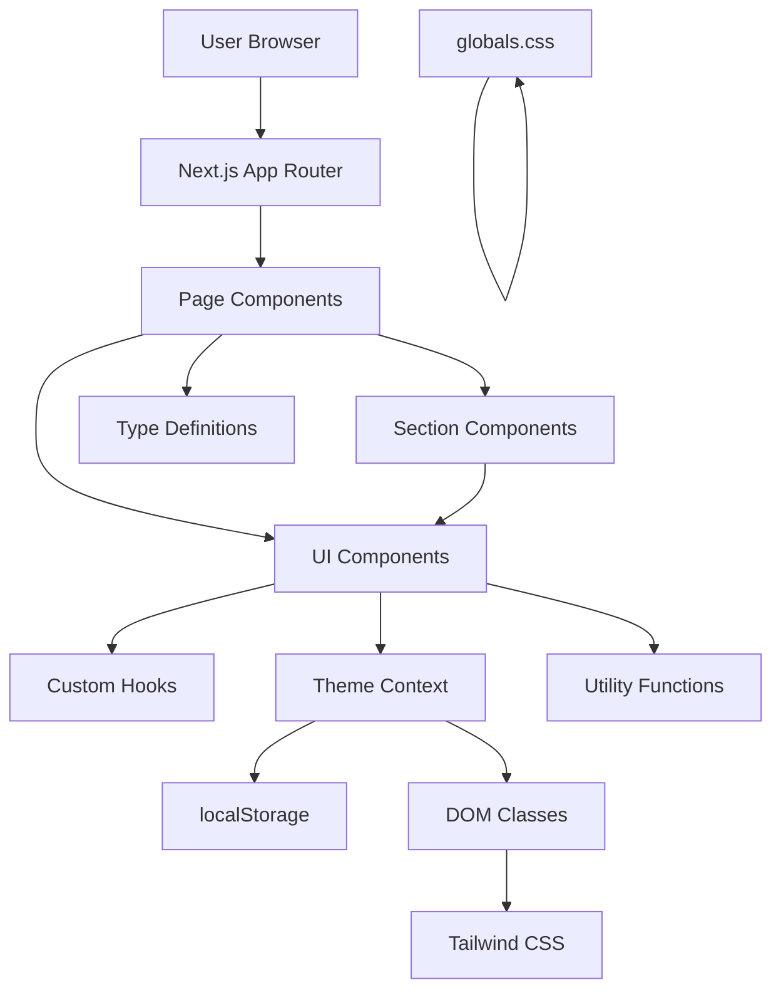
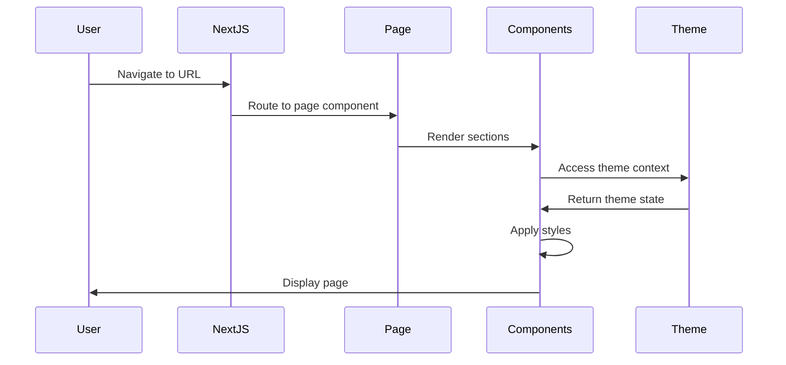
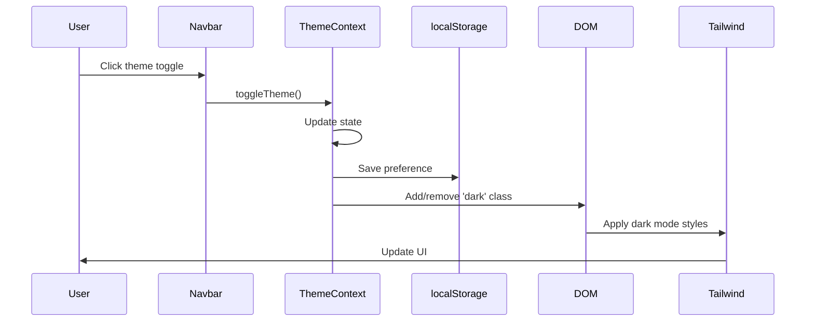
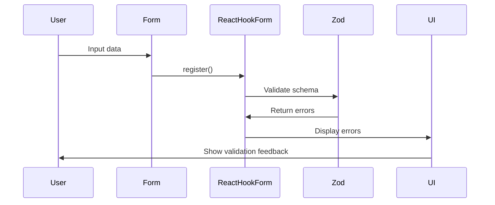

# Apex Fitness

A modern, responsive fitness center website built with Next.js 16, React 19, and TypeScript. Features a complete membership system, interactive tools, and premium UI with smooth animations.

## Table of Contents

- [Overview](#overview)
- [Features](#features)
- [Technology Stack](#technology-stack)
- [Architecture](#architecture)
- [Architecture Diagram](#architecture-diagram)
- [Project Structure](#project-structure)
- [How It Works](#how-it-works)
- [Core Features](#core-features)
- [Request / Data Flow](#request--data-flow)
- [Configuration](#configuration)
- [Environment Variables](#environment-variables)
- [Installation](#installation)
- [Development Setup](#development-setup)
- [Running the Project](#running-the-project)
- [Available Commands](#available-commands)
- [Testing](#testing)
- [Build](#build)
- [Deployment](#deployment)
- [Security](#security)
- [Error Handling](#error-handling)
- [Troubleshooting](#troubleshooting)
- [Known Limitations](#known-limitations)
- [Performance Considerations](#performance-considerations)
- [Development Guidelines](#development-guidelines)
- [Contributing](#contributing)
- [Future Improvements](#future-improvements)
- [License](#license)

## Overview

Apex Fitness is a comprehensive fitness center website designed to showcase gym services, membership plans, trainers, and blog content. The site features a modern design system with dark mode support, smooth animations powered by Framer Motion, and interactive tools like a BMI calculator and payment checkout flow.

The website is built as a single-page application using Next.js App Router, providing fast navigation and optimized performance. All pages are client-side rendered with interactive components for an engaging user experience.

## Features

### Core Functionality
- **Responsive Design**: Fully responsive layout optimized for mobile, tablet, and desktop
- **Dark Mode**: Global theme switcher with system preference detection
- **Interactive Animations**: Smooth page transitions, scroll animations, and hover effects
- **BMI Calculator**: Metric and imperial unit support with real-time calculations
- **Membership System**: Three-tier pricing (Basic, Pro, Elite) with monthly/yearly toggle
- **Payment Checkout**: Multi-method payment flow (Credit Card, PayPal, Apple Pay) with real-time validation
- **Blog System**: 7 blog posts with individual detail pages
- **Service Pages**: 6 detailed service pages with pricing and features
- **Contact Form**: Form validation using React Hook Form and Zod
- **AI Chatbot**: Interactive chatbot with quick replies and suggestions
- **Animated Statistics**: Counter animations for key metrics

### Pages
- **Home**: Hero section, stats, features, trainers preview, testimonials, FAQ, CTA
- **About**: Company story, mission, values, team stats, FAQ
- **Services**: Service grid, BMI calculator, class schedule teaser, FAQ
- **Service Details**: Individual pages for each service (6 total)
- **Membership**: Pricing cards, comparison table, billing toggle, FAQ
- **Checkout**: Payment form with validation for three payment methods
- **Checkout Success**: Payment confirmation with transaction details
- **Trainers**: Team showcase with social links and specialties
- **Blog**: Blog listing with 7 posts
- **Blog Details**: Individual blog post pages (7 total)
- **Contact**: Contact form with validation, location info, hours

## Technology Stack

### Frontend Framework
- **Next.js 16.2.2**: React framework with App Router for file-based routing
- **React 19.2.4**: UI library with modern hooks and concurrent features
- **TypeScript 6.0.2**: Type-safe JavaScript with enhanced developer experience

### Styling & UI
- **Tailwind CSS v4**: Utility-first CSS framework with dark mode support
- **Framer Motion 11.0.0**: Production-ready motion library for React animations
- **Lucide React**: Icon library with 1000+ customizable icons
- **shadcn/ui**: Reusable component library built on Radix UI primitives
- **clsx & tailwind-merge**: Utility functions for conditional class merging

### Forms & Validation
- **React Hook Form 7.51.0**: Performant form library with minimal re-renders
- **Zod 3.22.4**: TypeScript-first schema validation
- **@hookform/resolvers**: Zod resolver for React Hook Form

### Development Tools
- **ESLint 9**: Code linting with Next.js configuration
- **TypeScript Compiler**: Strict type checking with path aliases
- **PostCSS**: CSS transformation with Tailwind plugin

### Package Manager
- **npm**: Node package manager (via package-lock.json)

## Architecture

### Overall Architecture Pattern

The project follows a **client-side rendered** architecture using Next.js App Router. All pages use `"use client"` directive for interactive components. The application is organized as a single-page application with file-based routing.

### Application Layers

```
┌─────────────────────────────────────────┐
│         Browser / Client                 │
└──────────────┬──────────────────────────┘
               │
               ↓
┌─────────────────────────────────────────┐
│      Next.js App Router                 │
│  (File-based routing in src/app/)       │
└──────────────┬──────────────────────────┘
               │
               ↓
┌─────────────────────────────────────────┐
│      React Components                   │
│  (Pages, Sections, UI Components)       │
└──────────────┬──────────────────────────┘
               │
               ↓
┌─────────────────────────────────────────┐
│      Custom Hooks & Contexts            │
│  (Theme, Scroll Animation, BMI, etc.)   │
└──────────────┬──────────────────────────┘
               │
               ↓
┌─────────────────────────────────────────┐
│      Utility Functions                  │
│  (cn, type definitions)                 │
└─────────────────────────────────────────┘
```

### Module Boundaries

- **Pages**: Route-level components in `src/app/[route]/page.tsx`
- **Sections**: Reusable page sections in `src/components/sections/`
- **UI Components**: Reusable UI elements in `src/components/ui/`
- **Contexts**: Global state management in `src/contexts/`
- **Hooks**: Custom React hooks in `src/hooks/`
- **Types**: TypeScript type definitions in `src/types/`
- **Lib**: Utility functions in `src/lib/`

### Communication Between Modules

- **Pages → Sections**: Direct component composition
- **Components → Hooks**: Custom hooks for state and logic
- **Components → Contexts**: Global theme state via `useTheme()`
- **Components → Types**: TypeScript interfaces for props
- **Components → Utils**: `cn()` function for class merging

### Request/Response Lifecycle

Since this is a static website with client-side rendering:

1. User navigates to a URL
2. Next.js App Router matches the route to a page component
3. Page component renders with sections and UI components
4. Components use hooks for local state and animations
5. User interactions trigger state updates
6. React re-renders affected components
7. No server-side API calls (static content)

### Data Flow

**Local State Flow**:
```
User Input → useState → Component State → UI Update
```

**Theme Flow**:
```
Theme Toggle → ThemeContext → localStorage → DOM Class → Tailwind Styles
```

**Form Validation Flow**:
```
User Input → React Hook Form → Zod Schema → Validation Errors → UI Feedback
```

### Error Handling

- **Form Errors**: React Hook Form + Zod validation with inline error messages
- **Navigation Errors**: Next.js automatic 404 for missing routes
- **Console Logging**: Extensive console.log statements for debugging
- **Type Errors**: TypeScript strict mode catches at compile time

### Configuration Management

- **Next.js Config**: Minimal configuration in `next.config.ts`
- **TypeScript Config**: Path aliases (`@/*` → `./src/*`) in `tsconfig.json`
- **Tailwind Config**: Inline theme configuration in `globals.css`
- **Environment**: No environment variables required (static site)

## Architecture Diagram



## Project Structure

```
apex-fitness/
├── public/                          # Static assets
│   ├── *.png                       # Trainer and blog images
│   ├── *.svg                       # Icon assets
│   └── ...                         # Other static files
├── src/
│   ├── app/                        # Next.js App Router pages
│   │   ├── about/                  # About page
│   │   │   └── page.tsx
│   │   ├── blog/                   # Blog pages
│   │   │   ├── page.tsx            # Blog listing
│   │   │   ├── 1/                  # Blog post 1
│   │   │   │   └── page.tsx
│   │   │   ├── 2/                  # Blog post 2
│   │   │   │   └── page.tsx
│   │   │   ├── ...                 # Blog posts 3-7
│   │   │   └── 7/
│   │   │       └── page.tsx
│   │   ├── checkout/               # Checkout pages
│   │   │   ├── page.tsx            # Payment form
│   │   │   └── success/            # Payment confirmation
│   │   │       └── page.tsx
│   │   ├── contact/                # Contact page
│   │   │   └── page.tsx
│   │   ├── globals.css             # Global styles & Tailwind config
│   │   ├── layout.tsx              # Root layout with providers
│   │   ├── membership/             # Membership page
│   │   │   └── page.tsx
│   │   ├── page.tsx                # Home page
│   │   ├── services/               # Services pages
│   │   │   ├── page.tsx            # Services listing
│   │   │   ├── corporate-wellness/ # Service detail pages
│   │   │   ├── group-classes/
│   │   │   ├── nutrition-coaching/
│   │   │   ├── online-coaching/
│   │   │   ├── personal-training/
│   │   │   └── recovery-wellness/
│   │   ├── trainers/               # Trainers page
│   │   │   └── page.tsx
│   │   └── ...                     # Other pages
│   ├── components/                 # React components
│   │   ├── chatbot.tsx             # AI chatbot component
│   │   ├── footer.tsx              # Footer component
│   │   ├── navbar.tsx              # Navigation bar
│   │   ├── sections/               # Page sections
│   │   │   ├── cta.tsx             # Call-to-action section
│   │   │   ├── features.tsx        # Features section
│   │   │   ├── hero.tsx            # Hero section
│   │   │   └── testimonials.tsx    # Testimonials section
│   │   └── ui/                     # Reusable UI components
│   │       ├── accordion.tsx       # FAQ accordion
│   │       ├── bmi-calculator.tsx  # BMI calculator
│   │       ├── button.tsx          # Button component
│   │       └── cards.tsx           # Card components (Service, Trainer, Membership, etc.)
│   ├── contexts/                   # React contexts
│   │   └── theme.tsx              # Theme provider (dark/light mode)
│   ├── hooks/                      # Custom React hooks
│   │   ├── useAnimatedCounter.ts  # Animated number counter
│   │   ├── useBMICalculator.ts     # BMI calculation logic
│   │   └── useScrollAnimation.ts   # Scroll-based animations
│   ├── lib/                        # Utility functions
│   │   └── utils.ts               # cn() for class merging
│   └── types/                      # TypeScript definitions
│       └── index.ts               # All type interfaces
├── .gitignore                      # Git ignore rules
├── components.json                 # shadcn/ui configuration
├── eslint.config.mjs               # ESLint configuration
├── next-env.d.ts                   # Next.js TypeScript definitions
├── next.config.ts                  # Next.js configuration
├── package.json                    # Dependencies and scripts
├── package-lock.json               # Locked dependency versions
├── postcss.config.mjs              # PostCSS configuration
├── tsconfig.json                   # TypeScript configuration
└── README.md                       # This file
```

### Directory Responsibilities

- **`src/app/`**: Contains all page components using Next.js App Router file-based routing
- **`src/components/`**: Reusable React components organized by type (sections, UI, layout)
- **`src/contexts/`**: React Context providers for global state (theme)
- **`src/hooks/`**: Custom React hooks for reusable logic (animations, calculations)
- **`src/lib/`**: Utility functions and helpers
- **`src/types/`**: TypeScript type definitions used across the application
- **`public/`**: Static assets served directly (images, icons, fonts)

## How It Works

### Navigation Flow

The application uses Next.js App Router for file-based routing:

1. User navigates to a URL (e.g., `/services`)
2. Next.js matches the route to `src/app/services/page.tsx`
3. Page component renders with sections and UI components
4. Root layout (`src/app/layout.tsx`) wraps page with Navbar, Footer, Chatbot, and ThemeProvider
5. Components render with animations and interactivity

### Theme System

The theme system uses React Context with localStorage persistence:

1. `ThemeProvider` wraps the entire application in `layout.tsx`
2. Theme state (`light`, `dark`, `system`) stored in React state and localStorage
3. System preference detected via `window.matchMedia()`
4. Theme toggle updates state and localStorage
5. `useEffect` applies `dark` class to document.documentElement
6. Tailwind CSS `dark:` variants respond to the class

### Animation System

Animations are powered by Framer Motion:

1. Components use `motion.div` for animated elements
2. `initial`, `animate`, `whileHover`, `whileInView` props define animations
3. Scroll animations use `useScrollAnimation` hook
4. Parallax effects use `useParallax` hook
5. Staggered animations for children using `staggerChildren`

### Form Validation

Forms use React Hook Form with Zod validation:

1. Form schema defined using Zod (e.g., `contactFormSchema`)
2. `useForm` hook with `zodResolver` for validation
3. `register` function binds inputs to form state
4. Validation errors automatically generated from schema
5. Inline error messages displayed in UI

## Core Features

### 1. Theme System

**Purpose**: Provide dark/light mode switching with system preference detection

**Files**: `src/contexts/theme.tsx`, `src/components/navbar.tsx`

**Implementation**:
- React Context (`ThemeContext`) for global theme state
- localStorage persistence for user preference
- System preference detection via `window.matchMedia()`
- DOM class manipulation for Tailwind dark mode
- Theme toggle button in navbar

**Data Flow**:
```
User Clicks Toggle → setTheme() → localStorage → Theme State → DOM Class → Tailwind Styles
```

### 2. BMI Calculator

**Purpose**: Interactive tool for calculating Body Mass Index

**Files**: `src/components/ui/bmi-calculator.tsx`, `src/hooks/useBMICalculator.ts`

**Implementation**:
- Custom hook `useBMICalculator` for calculation logic
- Supports metric (kg/cm) and imperial (lbs/ft-in) units
- Real-time validation and result display
- Color-coded BMI categories (underweight, normal, overweight, obese)

**Data Flow**:
```
User Input → useState → calculateBMI() → BMI Result → Category & Color → UI Display
```

### 3. Membership & Checkout System

**Purpose**: Display pricing plans and process membership payments

**Files**: `src/app/membership/page.tsx`, `src/app/checkout/page.tsx`, `src/app/checkout/success/page.tsx`, `src/components/ui/cards.tsx`

**Implementation**:
- Three membership plans (Basic, Pro, Elite) with monthly/yearly pricing
- Monthly/yearly toggle with savings calculation
- Comparison table for feature comparison
- Checkout page with three payment methods (Credit Card, PayPal, Apple Pay)
- Real-time form validation for each payment method
- Success page with transaction details

**Data Flow**:
```
User Selects Plan → URL Params → Checkout Page → Form Validation → Payment → Success Page
```

### 4. Blog System

**Purpose**: Display fitness-related articles with individual detail pages

**Files**: `src/app/blog/page.tsx`, `src/app/blog/[id]/page.tsx` (7 pages)

**Implementation**:
- Blog listing page with 7 article cards
- Each card links to individual detail page
- Detail pages feature full article content
- Responsive typography with Tailwind prose classes
- Dark mode support throughout

**Data Flow**:
```
Blog Listing → User Clicks Card → Navigate to Detail Page → Display Full Content
```

### 5. Service Pages

**Purpose**: Showcase fitness services with detailed information

**Files**: `src/app/services/page.tsx`, `src/app/services/[service-id]/page.tsx` (6 pages)

**Implementation**:
- Services grid with 6 service cards
- Lucide React icons for professional appearance
- Each card links to detailed service page
- Detail pages include pricing, features, FAQs, and CTAs
- Consistent design across all service pages

**Data Flow**:
```
Services Grid → User Clicks Card → Navigate to Service Detail → Display Service Info
```

### 6. Chatbot

**Purpose**: Provide interactive support and quick navigation

**Files**: `src/components/chatbot.tsx`

**Implementation**:
- Floating chat button with minimize/maximize
- Proactive suggestions with dismissible notifications
- Quick reply options for common queries
- Smooth animations for open/close transitions
- Swipe gestures for mobile support

**Data Flow**:
```
User Clicks Chat Button → Open Chat Window → User Messages → Bot Responses → Quick Replies
```

## Request / Data Flow

### Page Navigation Flow



### Theme Toggle Flow



### Form Validation Flow



## Configuration

### Next.js Configuration

File: `next.config.ts`

Current configuration is minimal with no custom options. Default Next.js settings are used.

### TypeScript Configuration

File: `tsconfig.json`

Key settings:
- **Target**: ES2020
- **Module**: ESNext with bundler resolution
- **Strict Mode**: Enabled
- **Path Aliases**: `@/*` maps to `./src/*`
- **JSX**: React JSX transform
- **Incremental**: Enabled for faster builds

### Tailwind CSS Configuration

File: `src/app/globals.css`

Configuration is inline using Tailwind CSS v4 `@theme` directive:
- Custom color palette (orange variants)
- Custom border radius values
- Custom font variables
- Dark mode variant: `@custom-variant dark (&:is(.dark *))`

### ESLint Configuration

File: `eslint.config.mjs`

Uses Next.js ESLint configuration with TypeScript support.

## Environment Variables

This project does not require any environment variables. All configuration is done through code and static files.

No `.env` or `.env.example` files are present in the repository.

## Installation

### Prerequisites

- **Node.js**: Version 20.x or higher (recommended)
- **npm**: Version 9.x or higher (comes with Node.js)
- **Git**: For cloning the repository

### Installation Steps

1. **Clone the repository**:
   ```bash
   git clone https://github.com/ibrahim-amjad764/Apex-Fitness.git
   cd Apex-Fitness
   ```

2. **Install dependencies**:
   ```bash
   npm install
   ```

   This will install all dependencies listed in `package.json` including:
   - Next.js and React
   - Framer Motion
   - Tailwind CSS
   - React Hook Form and Zod
   - Lucide React icons
   - Development dependencies

## Development Setup

### Running the Development Server

1. **Start the development server**:
   ```bash
   npm run dev
   ```

   The application will be available at `http://localhost:3000`

2. **Open in browser**:
   Navigate to `http://localhost:3000` to view the application

### Development Workflow

1. Make changes to source files in `src/`
2. Next.js hot-reloads the application automatically
3. View changes in the browser
4. Check console for any errors or warnings

### TypeScript Type Checking

TypeScript type checking is performed automatically during development. Errors will appear in your editor and the terminal.

## Running the Project

### Development Mode

```bash
npm run dev
```

- Runs Next.js development server with hot-reload
- Uses webpack bundler (configured in package.json)
- Available at `http://localhost:3000`

### Production Mode

```bash
npm run build
npm run start
```

- `npm run build`: Creates an optimized production build
- `npm run start`: Starts the production server
- Uses Next.js production server

## Available Commands

### Development

```bash
npm run dev
```
Starts the development server with hot-reload and webpack bundler.

### Build

```bash
npm run build
```
Creates an optimized production build of the application.

### Production

```bash
npm run start
```
Starts the production server (requires build first).

### Linting

```bash
npm run lint
```
Runs ESLint to check code quality and identify potential issues.

## Testing

This project does not currently have a test suite configured.

No testing framework (Jest, Vitest, Cypress, etc.) is present in the dependencies.

### Future Testing Recommendations

- **Unit Tests**: Use Vitest or Jest for component testing
- **E2E Tests**: Use Playwright or Cypress for user flow testing
- **Visual Regression**: Use Storybook or Chromatic for UI testing

## Build

### Production Build

```bash
npm run build
```

The build process:
1. Compiles TypeScript to JavaScript
2. Optimizes React components
3. Generates static pages
4. Minifies CSS and JavaScript
5. Creates `.next` directory with build artifacts

### Build Output

Build artifacts are stored in the `.next` directory (not committed to git).

### Static Assets

Static assets in `public/` are served directly without processing.

## Deployment

### Deployment Options

#### Vercel (Recommended)

1. Push code to GitHub repository
2. Import project in Vercel
3. Vercel automatically detects Next.js
4. Deploy with default settings

#### Other Platforms

The application can be deployed to any platform that supports Next.js:
- Netlify
- AWS Amplify
- Digital Ocean App Platform
- Railway
- Render

### Build Configuration

No special build configuration is required. The application uses default Next.js settings.

### Environment

No environment variables are required for deployment.

### Docker

No Docker configuration is present in the repository.

To add Docker support, you would need to create:
- `Dockerfile`
- `docker-compose.yml`
- `.dockerignore`

## Security

### Current Security Measures

1. **TypeScript**: Type safety prevents many runtime errors
2. **React Hook Form + Zod**: Input validation on forms
3. **Next.js**: Built-in security features (XSS protection, CSP headers)
4. **No Secrets**: No sensitive data in codebase

### Security Considerations

- **No Authentication**: The site is public with no user authentication
- **No Backend**: Static site with no server-side processing
- **Form Submissions**: Contact form currently simulates submission (no real backend)
- **Payment Processing**: Checkout flow is a frontend simulation (no real payment processing)

### Recommendations for Production

1. **Contact Form**: Integrate with form service (Formspree, EmailJS) or backend API
2. **Payment Processing**: Integrate with payment provider (Stripe, PayPal)
3. **CSRF Protection**: Add CSRF tokens for forms if backend is added
4. **Rate Limiting**: Implement rate limiting for API endpoints
5. **Content Security Policy**: Configure CSP headers in Next.js config
6. **HTTPS**: Ensure HTTPS is enforced in production

## Error Handling

### Form Validation Errors

Forms use React Hook Form with Zod validation:
- Errors displayed inline below input fields
- Error messages defined in Zod schemas
- Visual feedback with red borders and error icons

### Navigation Errors

Next.js automatically handles:
- 404 pages for missing routes
- 500 pages for server errors
- Redirects for invalid URLs

### Console Logging

Extensive console.log statements throughout the codebase for debugging:
- Component mount logging
- State change logging
- Hook initialization logging
- Event handler logging

### TypeScript Errors

TypeScript strict mode catches type errors at compile time:
- Invalid prop types
- Missing required properties
- Type mismatches

## Troubleshooting

### Common Issues

#### Port Already in Use

If port 3000 is already in use:
```bash
# Kill process on port 3000 (Windows)
npx kill-port 3000

# Or use a different port
npm run dev -- -p 3001
```

#### Build Errors

If build fails:
1. Clear Next.js cache:
   ```bash
   rm -rf .next
   npm run build
   ```

2. Clear node_modules and reinstall:
   ```bash
   rm -rf node_modules package-lock.json
   npm install
   npm run build
   ```

#### TypeScript Errors

If TypeScript errors occur:
1. Check tsconfig.json configuration
2. Ensure all dependencies are installed
3. Verify type definitions in `src/types/index.ts`

#### Tailwind CSS Not Working

If Tailwind styles are not applied:
1. Ensure `globals.css` is imported in `layout.tsx`
2. Check Tailwind CSS v4 syntax in `globals.css`
3. Verify PostCSS configuration

#### Theme Not Switching

If dark mode doesn't work:
1. Check browser console for errors
2. Verify `ThemeProvider` wraps application in `layout.tsx`
3. Check localStorage for theme persistence
4. Ensure `dark` class is applied to document.documentElement

## Known Limitations

### Current Limitations

1. **No Backend**: Static site with no server-side processing
2. **No Real Database**: All data is hardcoded in components
3. **No Real Payment Processing**: Checkout flow is a simulation
4. **No Real Form Submission**: Contact form doesn't actually send emails
5. **No Authentication**: No user accounts or login system
6. **No Admin Panel**: No content management system
7. **No Testing**: No automated tests configured
8. **Console Logging**: Extensive console.log statements in production code

### Technical Debt

1. **Console Logging**: Should be removed or replaced with proper logging
2. **Hardcoded Data**: Should be moved to CMS or database
3. **No Error Boundaries**: No React error boundaries for graceful error handling
4. **No Loading States**: Some components lack loading indicators
5. **No SEO Optimization**: Basic metadata, could be enhanced

## Performance Considerations

### Optimization Techniques

1. **Next.js Automatic Optimization**:
   - Automatic code splitting
   - Image optimization with Next.js Image component
   - Font optimization with next/font

2. **Framer Motion Performance**:
   - `layout` prop for smooth layout animations
   - GPU-accelerated transforms
   - RequestAnimationFrame for scroll animations

3. **Tailwind CSS**:
   - Purge unused styles in production
   - Minimal CSS bundle size
   - Utility-first approach reduces custom CSS

4. **React Performance**:
   - Component memoization potential (not currently used)
   - Lazy loading potential for large components
   - useEffect cleanup for event listeners

### Recommendations

1. **Add Loading States**: Improve perceived performance
2. **Implement Skeleton Screens**: Better loading experience
3. **Optimize Images**: Use WebP format, compress images
4. **Add Service Worker**: Enable offline support
5. **Implement Code Splitting**: Lazy load heavy components
6. **Use React.memo**: Prevent unnecessary re-renders
7. **Add Analytics**: Monitor performance metrics

## Development Guidelines

### Code Style

- **TypeScript**: Use strict mode, avoid `any` type
- **Components**: Use functional components with hooks
- **Naming**: Use descriptive names for components, functions, variables
- **File Names**: Use kebab-case for files, PascalCase for components
- **Imports**: Group imports (React, third-party, local)
- **Comments**: Add JSDoc comments for complex functions

### Component Structure

```typescript
"use client" // if needed

import { useState, useEffect } from "react"
import { motion } from "framer-motion"

console.log("[component] - Component loaded")

// Type definitions (if needed)
interface Props {
  // ...
}

// Helper functions
function helper() {
  // ...
}

// Main component
export function Component({ prop }: Props) {
  // Hooks
  const [state, setState] = useState()

  // Effects
  useEffect(() => {
    // ...
  }, [])

  // Handlers
  const handleClick = () => {
    // ...
  }

  // Render
  return (
    // JSX
  )
}
```

## Contributing

### Contribution Guidelines

1. **Fork the repository**
2. **Create a feature branch**: `git checkout -b feature/your-feature`
3. **Make changes** following development guidelines
4. **Test changes** in development mode
5. **Commit changes** with descriptive messages
6. **Push to branch**: `git push origin feature/your-feature`
7. **Open a pull request**

### Commit Message Format

Use conventional commit format:
```
feat: add new feature
fix: fix bug
docs: update documentation
style: format code
refactor: refactor code
test: add tests
chore: update dependencies
```

## Future Improvements

### Planned Features

1. **Backend Integration**:
   - Add API routes for form submissions
   - Integrate with database (PostgreSQL, MongoDB)
   - Implement authentication (NextAuth.js)

2. **CMS Integration**:
   - Add content management system (Sanity, Contentful)
   - Enable dynamic content editing
   - Add blog authoring interface

3. **E-commerce Integration**:
   - Real payment processing (Stripe)
   - Membership management system
   - Recurring billing

4. **User Features**:
   - User accounts and profiles
   - Workout tracking
   - Progress dashboard
   - Class booking system

5. **Performance**:
   - Add automated testing
   - Implement service worker
   - Add performance monitoring
   - Optimize images and assets

6. **SEO**:
   - Add structured data (JSON-LD)
   - Optimize meta tags
   - Add sitemap
   - Implement robots.txt

### Technical Improvements

1. **Remove Console Logging**: Replace with proper logging library
2. **Add Error Boundaries**: Implement graceful error handling
3. **Add Loading States**: Improve loading experience
4. **Implement Skeleton Screens**: Better perceived performance
5. **Add Analytics**: Monitor user behavior and performance
6. **Add CI/CD**: Automated testing and deployment
7. **Add Docker**: Containerized deployment

## License

This project is private. No license information is provided in the repository.

---

